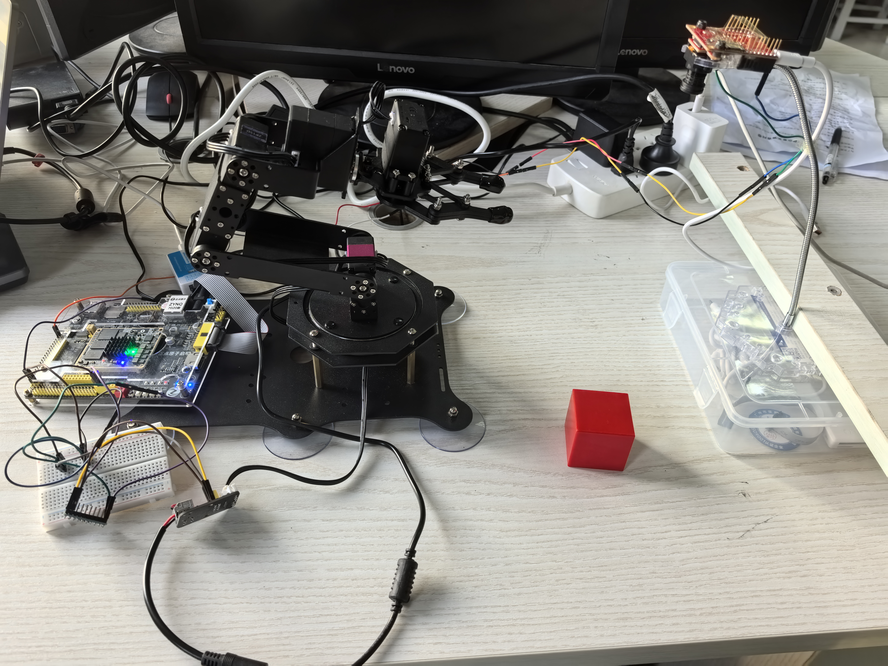
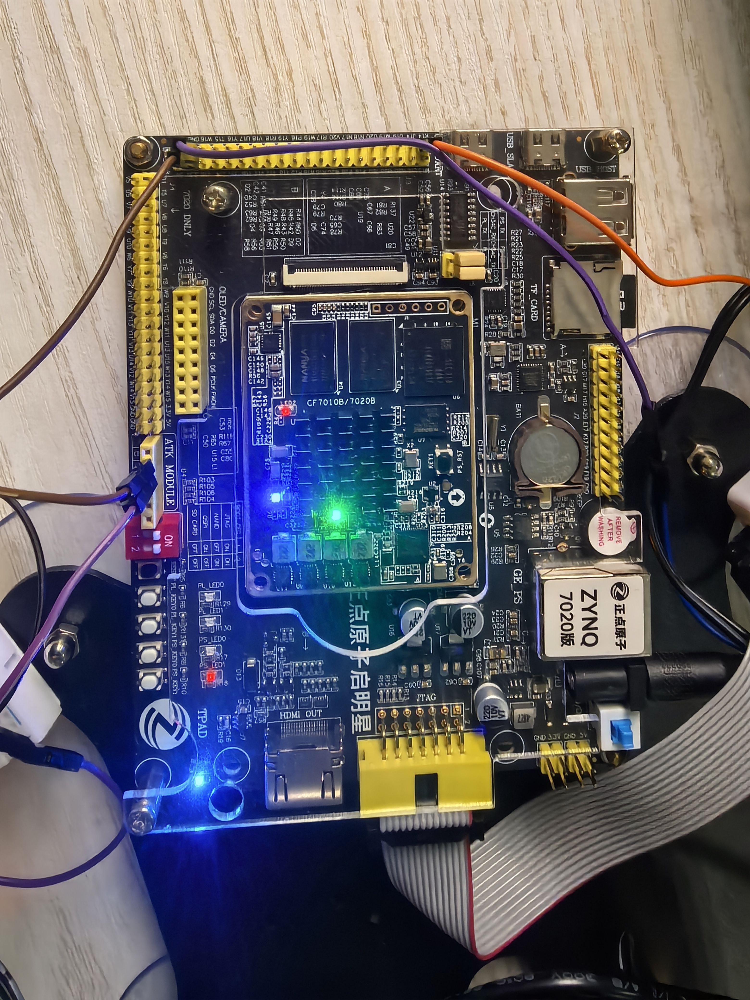

# FPGA 视觉引导机械臂 V4

OpenMV 采集并通过 UART 发送图像。Zynq-7020 的可编程逻辑执行整数模型推理、3 cm 邻域选物和抓放调度。

## 实物照片

| 指南目录 | 本仓库对应路径 |
| --- | --- |
| src | src/v4/rtl、src/v4/camera、src/v4/model_development |
| sim | src/v4/sim、src/v4/scripts/test_v4_radius.ps1、src/v4/scripts/test_coordinates.ps1 |
| build | src/v4/tcl、src/v4/release |
| board | src/v4/vivado、src/v4/constraints、src/v4/camera |
| data | src/v4/work/coordinate_test、src/v4/config、src/v4/model_candidates |
| skill | 本工程未使用独立技能包作为构建依赖 |
| report | report、src/v4/reports |

保留 src/v4 内部目录关系，以便 Vivado 工程、构建脚本和仿真向量沿用相对引用。

## 复现步骤

1. 打开 Vivado 2018.3 工程 src/v4/vivado/v4.xpr，器件为 xc7z020clg400-2。
2. 使用 Vivado 批处理运行 src/v4/tcl/build.tcl。已验证的比特流位于 src/v4/release/v4.bit。
3. 运行 src/v4/scripts/test_v4_radius.ps1 和 test_coordinates.ps1。Vivado 安装位置不同时调整脚本内的工具路径。
4. 查看 src/v4/reports/delivery.json 和 src/v4/release/timing.rpt。四项 RTL 仿真通过，50 MHz 下 WNS 为 1.611 ns、WHS 为 0.057 ns，DRC 错误数为 0。

参见 [提交说明](src/v4/submission.md) 和 [设计与协作记录](report/design-notes.md)。
